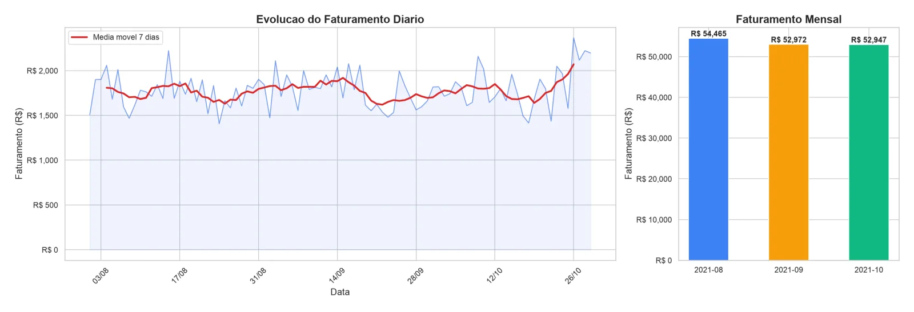
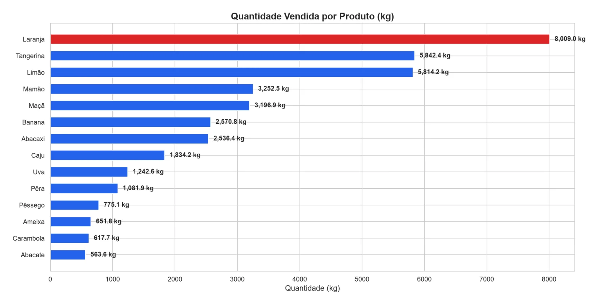
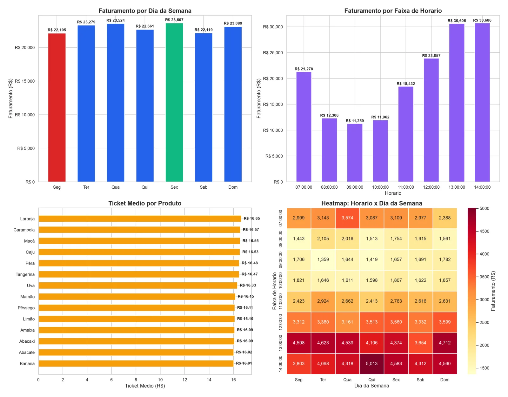
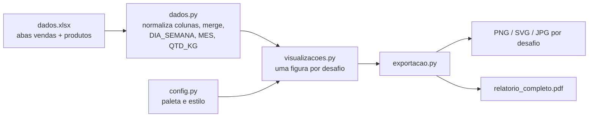

# Análise de Vendas - Feira (teste técnico Driva)

Teste técnico de Inteligência de Mercado para a Driva: responder cinco perguntas de negócio sobre as vendas de uma banca de frutas a partir de uma planilha Excel. A solução é um pacote Python que lê a planilha, cruza vendas com produtos e gera um gráfico por pergunta, em PNG e num PDF consolidado.



## As perguntas e as respostas

A planilha `dados.xlsx` traz as abas `vendas` (9.806 vendas de 01/08 a 29/10/2021), `produtos` (14 frutas, preço/kg e peso médio) e uma aba vazia por pergunta. `dados_respondido.xlsx` é a mesma planilha com as respostas preenchidas.

| # | Pergunta | Resposta (aba `Gabarito`) | Gráfico gerado |
|---|---|---|---|
| 1 | Como está a evolução do faturamento? | Estável, leve queda de 2,8% (ago R$ 54.465, out R$ 52.947). Total R$ 160.383,88 | `desafio1_evolucao_faturamento` |
| 2 | Qual foi o melhor dia em vendas? | 26/10/2021 (terça), R$ 2.365,34 | `desafio2_melhor_dia` |
| 3 | Em que dia mais vendi Bananas? | 28/10/2021 (quinta), R$ 291,72 | `desafio3_banana` |
| 4 | Qual produto vendo em maior quantidade (kg)? | Laranja, 8.009 kg (21,1% do volume) | `desafio4_quantidade_kg` |
| 5 | Que estratégias aumentariam o faturamento? | Promoções na segunda, ações às 09h, cross-selling, fidelidade, estoque nos horários de pico, acompanhar sazonalidade | `desafio5_estrategias` |

A quantidade em kg não vem pronta: é calculada como `VALOR_VENDA / PRECO_KG`.



O gráfico da pergunta 5 junta os indicadores que sustentam as sugestões: faturamento por dia da semana, por faixa de horário, ticket médio por produto e um heatmap horário x dia.



## Como funciona



- `dados.py`: lê as duas abas, normaliza os nomes das colunas (tira acento, então `PREÇO_KG` vira `PRECO_KG`), faz o merge por `ID_PRODUTO` e avisa se houver venda sem produto.
- `visualizacoes.py`: `evolucao_faturamento`, `melhor_dia`, `vendas_produto`, `quantidade_kg` e `estrategias`, cada uma devolve uma `matplotlib.Figure`.
- `exportacao.py`: salva cada figura nos formatos pedidos e, se `pdf` estiver entre eles, monta o PDF com todas.
- `__main__.py`: a CLI.

## Stack

Python 3, pandas, matplotlib, seaborn, openpyxl.

## Como rodar

```bash
python3 -m venv .venv
source .venv/bin/activate
pip install pandas matplotlib seaborn openpyxl
```

Sempre a partir da raiz do projeto:

```bash
# PNGs em ./output
python -m analise_vendas dados.xlsx

# Outra pasta de saída
python -m analise_vendas dados.xlsx --output ./relatorios

# PNG + PDF consolidado
python -m analise_vendas dados.xlsx --formato png pdf

# Outro produto na pergunta 3 e rankings com 5 itens
python -m analise_vendas dados.xlsx --produto Laranja --top 5
```

| Opção | Padrão | O que faz |
|---|---|---|
| `--output`, `-o` | `./output` | pasta de saída |
| `--formato`, `-f` | `png` | um ou mais de `png`, `pdf`, `svg`, `jpg` |
| `--produto`, `-p` | `Banana` | produto analisado na pergunta 3 |
| `--top`, `-t` | `10` | tamanho dos rankings |

Sem interface gráfica (servidor, CI), use `MPLBACKEND=Agg python -m analise_vendas dados.xlsx`.

A execução imprime um resumo da base antes de gerar os gráficos:

```
RESUMO DA BASE
============================================================
  Periodo........: 01/08/2021 a 29/10/2021
  Registros......: 9,806
  Produtos.......: 14
  Faturamento....: R$ 160,383.88
```

### Como biblioteca

```python
from analise_vendas.config import aplicar_estilo
from analise_vendas.dados import carregar_dados
from analise_vendas.visualizacoes import evolucao_faturamento

aplicar_estilo()
df = carregar_dados("dados.xlsx")
evolucao_faturamento(df).savefig("meu_grafico.png")
```

### Formato esperado do Excel

- aba `produtos`: `ID_PRODUTO`, `NOME_PRODUTO`, `PRECO_KG` ou `PREÇO_KG`, `PESO_MEDIO_UNITARIO_KG`
- aba `vendas`: `DATA`, `ID_PRODUTO`, `VALOR_VENDA`, `FAIXA_HORARIO`

Cores, tamanhos e DPI ficam em `PALETA` e `STYLE_CONFIG` no [`analise_vendas/config.py`](analise_vendas/config.py).

## Estrutura

```
.
├── analise_vendas/
│   ├── __main__.py       # CLI
│   ├── config.py         # paleta, estilo, dias da semana em pt-BR
│   ├── dados.py          # leitura e preparação
│   ├── visualizacoes.py  # gráficos dos 5 desafios
│   ├── exportacao.py     # PNG/SVG/JPG e PDF consolidado
│   └── formatacao.py     # formatação em R$ e rótulos das barras
├── dados.xlsx            # planilha original do teste
├── dados_respondido.xlsx # planilha com as respostas
└── docs/media/           # gráficos usados neste README
```
